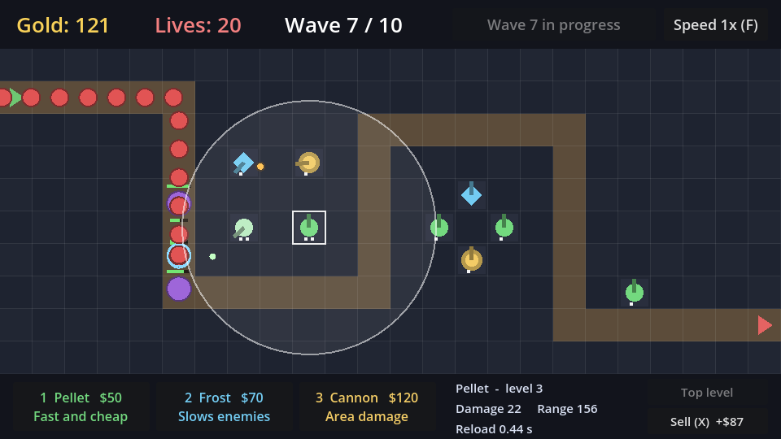
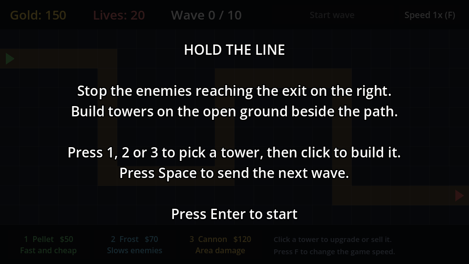
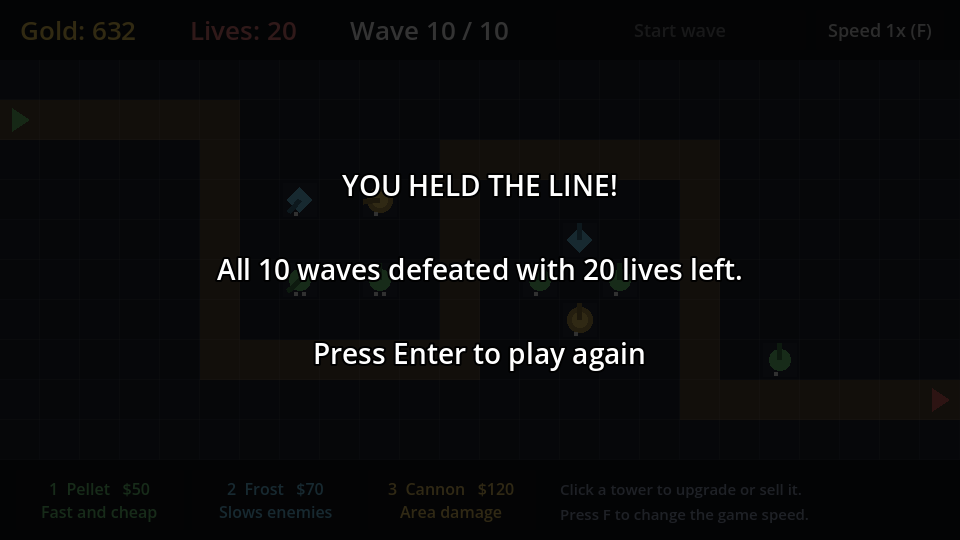

# Hold the Line

A small tower defense game made with [Godot 4](https://godotengine.org/). Enemies walk a winding path from the left edge to the exit on the right. Build towers beside the path, upgrade them, and stop all 10 waves before you run out of lives.



No art or sound files: everything is drawn in code, so the whole project is plain text you can read, diff and change.

## Play

1. Install Godot 4.7 or newer (the standard version, not the .NET one) from [godotengine.org](https://godotengine.org/download).
2. Start Godot, click **Import**, and pick `project.godot` in this folder.
3. Press **F5** to play. (Or from a terminal in this folder: `godot --path .`)

| Control | Action |
| ------- | ------ |
| 1, 2, 3 or the buttons at the bottom | Pick a tower to build (press again to put it away) |
| Left click | Build the picked tower, or select a tower to see its range and upgrade or sell it |
| Right click or Esc | Cancel the pick or close the tower panel |
| Space (or the top button) | Send the next wave |
| U / X (or the panel buttons) | Upgrade / sell the selected tower |
| F (or the top button) | Game speed: 1x, 2x, 3x |
| Enter | Start, and play again |

## How it plays

You start with $150 and 20 lives. Towers can go on any open square, but not on the path. Killing enemies pays gold, clearing a wave pays a $25 bonus, and an enemy that reaches the exit costs you lives. Win by clearing wave 10.

| Tower | Cost | Range | Damage | Reload | What it does |
| ----- | ---- | ----- | ------ | ------ | ------------ |
| Pellet | $50 | 130 | 10 | 0.55 s | Fast and cheap |
| Frost | $70 | 110 | 3 | 0.8 s | Slows enemies to half speed for 2 s |
| Cannon | $120 | 150 | 30 | 1.5 s | Hurts everything within 52 px of where the shell lands |

(Range is in pixels; one grid square is 40.) Every tower shoots the enemy that has walked furthest along the path. Each upgrade adds 60% of the base damage, 10% range and a 10% shorter reload, and makes frost slow harder. Level 2 costs 60% of the tower's price, level 3 costs 90%. Selling returns 70% of everything you spent on it.

| Enemy | Health | Speed | Reward | Lives lost if it leaks |
| ----- | ------ | ----- | ------ | ---------------------- |
| Grunt | 30 | 70 | $5 | 1 |
| Runner | 18 | 125 | $4 | 1 |
| Tank | 140 | 42 | $18 | 3 |

Enemies get 40% of their starting health added per wave, so a wave 10 grunt has 4.6 times the health of a wave 1 grunt.

Things worth knowing: the square in the exact middle of each of the two U-shaped loops is 120 px from the path on all three sides, so a frost tower (range 110) placed there can't reach anything. Buying upgrades before you have a third tower, and specialist towers before more pellet towers, costs lives in the early waves (see the balance test below).

| Title | Win |
| ----- | --- |
|  |  |

## How the project is organised

```text
scenes/
    main.tscn      the only scene: the board, the layers for towers/enemies/shots, the overlay and the HUD
scripts/
    data.gd        every number that shapes the game: path, towers, enemies, waves
    board.gd       the map: which cells are path, and how far along the path a point is
    game.gd        the game manager: gold, lives, waves, building, upgrading, selling, win and lose
    enemy.gd       walks the path, takes damage, can be slowed
    tower.gd       picks a target and fires
    projectile.gd  flies to its target, or to where the target was
    effect.gd      the ring drawn when a cannon shell lands
    overlay.gd     the build preview and range circles, drawn above everything
    hud.gd         the top bar, tower palette, tower panel and messages, built in code
tools/
    smoke_test.gd    automated check of the game rules (see below)
    balance_test.gd  plays whole games with scripted players to check the difficulty
    screenshot.gd    saves the pictures in docs/
export_presets.cfg   a ready "Web" export (single-threaded, so it needs no special server settings)
```

Two ideas hold it together:

- **Things report, the manager decides.** An enemy only says `died` or `leaked`, a tower only says `fired`, a projectile only says `hit`. `game.gd` decides what that means (gold, lives, damage, splash). The rules live in one place.
- **One clock.** Everything that moves is driven by `tick(delta)` in `game.gd`. That keeps the rules separate from the drawing, and it lets the tests run a whole 10-wave game in about a second by calling `tick()` in a loop.

## Automated tests

`tools/smoke_test.gd` checks the rules without a window: the numbers in `data.gd`, the map, building and its refusals, upgrading and selling, targeting, fire rate, splash damage, slowing, whole waves, and winning and losing. It also sends input actions (the named keys) and mouse clicks to the game. The exit code is 0 if everything passed, otherwise the number of failed checks.

```bash
godot --headless --path . --script res://tools/smoke_test.gd
```

Output of the last run:

```text
PASS  there are 10 waves
PASS  every wave uses enemy types that exist
PASS  wave 1 is 6 grunts, one a second (last at 5.0 s)
PASS  wave 4 is 10 grunts then 6 runners
PASS  wave 4's runners start 2 s after the last grunt (8.30 s)
PASS  enemy health grows by 40% of its starting value per wave (30 on wave 1, 90 on wave 6)
PASS  enemies made before wave 1 (in tests) have their base health
PASS  a pellet tower upgrades for $30 then $45
PASS  a level 3 pellet tower cost $125 in total
PASS  selling returns 70% rounded down ($35 at level 1, $87 at level 3)
PASS  a level 3 cannon sells for $210
PASS  each level adds 60% damage (10, 16, 22)
PASS  levels add range and shorten the cooldown
PASS  frost slows to 50% at level 1 and 30% at level 3
PASS  the path covers 43 cells (43)
PASS  the path is 1680 px long (1680)
PASS  the path starts just left of the board
PASS  240 px along is the first corner
PASS  past the end is the exit
PASS  (5,3) is on the path and the build spot is not
PASS  a cell's centre maps back to the cell
PASS  the game starts on the title screen
PASS  the title message is shown
PASS  pressing start begins the game
PASS  a game starts with $150, 20 lives, wave 0
PASS  the message is hidden while playing
PASS  the top bar shows gold and lives
PASS  the start button offers wave 1
PASS  you can't build on the path
PASS  you can't build outside the board
PASS  the off-board start of the path is outside
PASS  an unknown tower type is refused
PASS  a tower you can't afford is refused
PASS  a free cell with enough gold is fine
PASS  building a pellet tower costs $50 (gold is 100)
PASS  the tower is registered on its cell
PASS  the tower stands in the middle of its cell
PASS  a second tower on the same cell is refused, free of charge
PASS  the player is told why
PASS  the top bar shows the new gold
PASS  selecting a tower shows its panel
PASS  the upgrade button shows the price
PASS  the sell button shows the refund
PASS  upgrading to level 2 costs $30
PASS  an upgraded tower hits harder
PASS  upgrading to level 3 costs $45
PASS  level 3 is the top
PASS  the upgrade button says so and is disabled
PASS  selling a level 3 pellet returns $87
PASS  a sold tower is gone and its cell is free again
PASS  the cell can be built on again
PASS  an upgrade you can't afford is refused
PASS  its button is disabled
PASS  key 2 picks the frost tower
PASS  pressing 2 again puts it away
PASS  Escape cancels the pick
PASS  towers you can't afford are dimmed in the palette
PASS  the game reads a click at a cell's centre as that cell (read (9, 3))
PASS  a left click builds the picked tower
PASS  the pick stays active for the next tower
PASS  a right click cancels the pick
PASS  clicking a tower selects it
PASS  clicking empty ground deselects
PASS  the speed button goes to 2x
PASS  and back round to 1x after 3x
PASS  a tower shoots the enemy furthest along the path
PASS  and the next one once that has gone
PASS  an enemy out of range is ignored
PASS  a pellet tower fires 4 times in 2 seconds (fired 4)
PASS  each pellet that lands does 10 damage (took 40)
PASS  three pellets kill a grunt and it is removed
PASS  a grunt pays $5 (gold went 950 -> 955)
PASS  a cannon shell hurts every enemy near the impact (140 -> 110 and 110)
PASS  but not one 110 px away
PASS  the cannon fired at the front enemy
PASS  a shell whose target died still lands there and hurts its neighbour (110)
PASS  a pellet whose target died is removed and hurts nobody else
PASS  a slowed grunt walks at half speed
PASS  a weaker slow does not replace a stronger one
PASS  it covers 35 px in a second
PASS  the slow wears off after its 2 seconds
PASS  a frost tower's shot slows an enemy to half speed
PASS  a wave can be started
PASS  but not twice
PASS  the start button is disabled during a wave
PASS  the first enemy appears at once
PASS  and the next one a second later
PASS  all 6 grunts of wave 1 are out after 5 seconds
PASS  the wave ends once nothing is left
PASS  six grunts that got through cost 6 lives (lives 14)
PASS  clearing the wave pays $25 (gold 175)
PASS  the player is told the wave is cleared
PASS  the start button offers wave 2
PASS  Space starts the next wave
PASS  a tank that leaks costs 3 lives (lives 17)
PASS  (a tower is selected before the loss)
PASS  running out of lives loses the game
PASS  the game over message is shown
PASS  the game stands still after losing
PASS  no towers can be picked after losing
PASS  the tower panel is closed after losing
PASS  Enter starts a fresh game after losing
PASS  and the board is cleared
PASS  the last wave is wave 10
PASS  clearing the last wave wins the game
PASS  the win message is shown
PASS  no lives were lost in the stand-in defence
PASS  there is no wave 11
PASS  nothing can be built after winning
PASS  and nothing can be sold or upgraded
110 checks, 0 failed
```

`tools/balance_test.gd` plays full games with scripted players and checks that the difficulty has the shape it should: doing nothing loses early, a careful plan wins but not without losing a life, the same towers bought in a worse order do worse, and a lazy plan of cheap towers never wins.

```bash
godot --headless --path . --script res://tools/balance_test.gd
```

```text
== no towers at all
   wave  1 cleared: lives 14 (lost 6), gold  175,  0 towers
   wave  2 cleared: lives  4 (lost 10), gold  200,  0 towers
   LOST on wave 3
== pellet towers only, never upgraded
   wave  1 cleared: lives 20 (lost 0), gold   55,  3 towers
   wave  2 cleared: lives 20 (lost 0), gold   30,  5 towers
   wave  3 cleared: lives 20 (lost 0), gold   37,  6 towers
   wave  4 cleared: lives 20 (lost 0), gold   36,  8 towers
   wave  5 cleared: lives 20 (lost 0), gold   57, 10 towers
   wave  6 cleared: lives 20 (lost 0), gold   38, 12 towers
   wave  7 cleared: lives 20 (lost 0), gold   55, 15 towers
   wave  8 cleared: lives 12 (lost 8), gold    6, 19 towers
   wave  9 cleared: lives 12 (lost 0), gold  189, 20 towers
   LOST on wave 10
== a hasty mix: upgrades first, fewer towers early
   wave  1 cleared: lives 20 (lost 0), gold   45,  2 towers
   wave  2 cleared: lives 20 (lost 0), gold   50,  3 towers
   wave  3 cleared: lives 20 (lost 0), gold  107,  3 towers
   wave  4 cleared: lives 15 (lost 5), gold   63,  4 towers
   wave  5 cleared: lives 15 (lost 0), gold   54,  6 towers
   wave  6 cleared: lives 15 (lost 0), gold   35,  7 towers
   wave  7 cleared: lives  5 (lost 10), gold  143,  7 towers
   wave  8 cleared: lives  5 (lost 0), gold   50,  8 towers
   wave  9 cleared: lives  5 (lost 0), gold  161,  9 towers
   wave 10 cleared: lives  5 (lost 0), gold  170, 10 towers
   WON with 5 lives left (24 plan steps done of 24)
== a careful mix: more towers first, then upgrades
   wave  1 cleared: lives 20 (lost 0), gold   55,  3 towers
   wave  2 cleared: lives 20 (lost 0), gold   70,  3 towers
   wave  3 cleared: lives 20 (lost 0), gold  127,  3 towers
   wave  4 cleared: lives 19 (lost 1), gold   32,  5 towers
   wave  5 cleared: lives 19 (lost 0), gold   73,  6 towers
   wave  6 cleared: lives 19 (lost 0), gold   34,  7 towers
   wave  7 cleared: lives 16 (lost 3), gold   39,  7 towers
   wave  8 cleared: lives 16 (lost 0), gold   68,  8 towers
   wave  9 cleared: lives 16 (lost 0), gold   71, 10 towers
   wave 10 cleared: lives 16 (lost 0), gold  230, 10 towers
   WON with 16 lives left (24 plan steps done of 24)
PASS  doing nothing loses by wave 4 (lost on wave 3)
PASS  a careful plan wins
PASS  and wins comfortably (16 lives left)
PASS  but not without a scratch (16 lives left)
PASS  the hasty order does worse than the careful one (won with 5 lives)
PASS  a lazy plan of cheap, never-upgraded towers does not win (wave 10)
6 checks, 0 failed
```

To retake the screenshots in `docs/` (this opens a game window for a couple of seconds, so don't add `--headless`):

```bash
godot --path . --script res://tools/screenshot.gd
```

## What is and isn't checked

- The rules, the numbers and the difficulty curve are checked as above. When I broke the game on purpose in a scratch copy (towers shooting the last enemy instead of the first, a leaking tank costing 1 life, frost not slowing, selling returning 100%, building on the path, a weak slow replacing a strong one), the smoke test failed every time.
- The mouse and the buttons were also tried by hand in a browser build: the preview under the cursor, building, selecting, upgrading, selling and the tower buttons all worked.
- The difficulty was tuned against scripted players, not people. A human will place towers less cleverly, so it may play harder than the balance test suggests.
- The smoke test turns off the window's content scaling so that mouse positions are exact. How the real window scales clicks is covered by the browser check above, not by an automated test.

## Licence

MIT, see [LICENSE](LICENSE).

## Ideas for next steps

- Sound effects and a few more particles.
- A fourth tower, for example a laser that hits everything in a line.
- A high score (fewest lives lost) that is saved between runs.
- More than one map, picked on the title screen.
